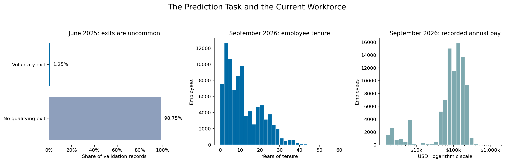

# Predicting Six-Month Voluntary Attrition
## Capstone Final Report

**Leo Lin · Workforce Planning & Analytics · Kaiser Permanente**

**[Final Report notebook](https://github.com/leosj168/workforce-attrition-capstone/blob/main/Final%20Report/attrition_model_train_reg.ipynb)**

## 1. Define the Problem Statement

HR teams cannot review every employee individually. I explored whether monthly workforce information could identify a more focused group for supportive retention review over the following six months.

The goal is to find potential exit cases while keeping review work manageable. Challenges include uncommon exits, repeated monthly records, incomplete recent outcomes and changing workforce conditions. The model supports planning; it does not establish why someone leaves or what employment action should follow.

## 2. Model Outcomes or Predictions

This is **supervised binary classification**. For each employee-month, the target is **1** for a qualifying voluntary exit within six months and **0** when no such exit is recorded. A zero does not rule out other types of departure.

The output ranks review priority. A cutoff creates the review list. Scores are not calibrated departure probabilities, and risk bands are not counts of expected exits.

## 3. Data Acquisition

I created the SQL Server stored procedure `Attrition.Employee_Comp_Monthly`. It combines workforce, compensation, performance and manager-team information with exit outcomes through **one governed extract**; no independent external dataset was added.

The source contains **3,273,117 employee-month records across 36 snapshots**, October 2023–September 2026. Of these, **2,548,054 records through January 2026** have complete outcomes. These are monthly records, not unique employees across the entire history.

The inital EDA found uncommon exits, around **1.3%**, and shorter median tenure among employees who later left—roughly **three years versus nine years**. Pay-position differences were smaller. Department patterns and unusual pay values required business context, rather than causal conclusions. These findings guided the final inputs and evaluation approach.

The left panel shows June 2025 validation, where **1.25%** of records have the target exit. The other panels describe September 2026 employees, whose mature outcomes are not yet known.

## 4. Data Preprocessing/Preparation

I checked duplicates, types, missingness and unusual ranges. Identifiers and future termination details were excluded from predictors. Non-finite values were treated as missing, with numeric replacements learned from training medians inside the pipelines and scaling where appropriate. Tested categories were imputed and one-hot encoded, but did not improve development results enough to retain them. The final models use **13 numeric inputs**, including engineered indicators and a pay–tenure interaction.

Missing outcomes were never filled as retention. Excluding whole recent or incomplete snapshots removed **725,063 records** and left no missing targets in retained history.

| Purpose | Period | Records |
|---|---|---:|
| Training | October 2023–November 2024 | 1,272,081 |
| Validation | June 2025 | 91,167 |
| Historical check | January 2026 | 90,988 |

These groups use a subset of the mature history. Calendar gaps keep earlier six-month outcome windows from overlapping the next forecast date. Two earlier calendar checks guide development; validation chooses the final model and cutoff.

## 5. Modeling

I compared three classifiers on the same selected inputs:

| Model | Purpose | Search |
|---|---|---|
| Logistic Regression | Interpretable linear benchmark | Grid search over regularization, weighting and training-only under-sampling |
| Random Forest | Capture nonlinear patterns through combined trees | Focused randomized search over tree complexity |
| Histogram Gradient Boosting | Capture interactions through sequential trees | Grid search across eight simpler configurations |

All searches use the same two calendar-based development checks. The selected booster limits each tree to **five leaves**, requires at least **1,000 records per leaf**, and uses stronger regularization to reduce overfitting. Its internal early-stopping split is random within training, a qualification discussed in the notebook.

## 6. Model Evaluation

**Average precision (AP)** is the primary development metric because exits are uncommon; it summarizes how well cases rank near the top. Predicting no exit for everyone would be 98.75% accurate on validation while finding no cases, so accuracy alone is misleading.

**Recall** measures the share of exit cases captured. **Precision** measures the share of reviewed records with a later qualifying exit. At similar recall, higher precision means less review work. ROC-AUC provides a supplementary ranking measure.

Eligibility requires at least **25% validation recall** and a training-to-development AP gap within **five percentage points**. Among eligible models, higher precision wins; review-list share and AP break ties.

| Model | AP | Precision | Recall | Reviews | Development gap |
|---|---:|---:|---:|---:|---:|
| Logistic Regression | 3.38% | 4.79% | 25.0% | 5,974 | 2.05 pp |
| Random Forest | 3.51% | 4.87% | 25.0% | 5,877 | 6.43 pp |
| **Gradient Boosting** | **3.71%** | **5.37%** | **25.0%** | **5,326** | **3.65 pp** |

Gradient Boosting was selected. It captured the same **286 of 1,142 validation exit cases** as Logistic Regression with **648 fewer reviews— a 10.8% reduction**. Random Forest failed the development-gap safeguard. See the [review-workload comparison](images/model_comparison.png).

The January historical replay was weaker for boosting: **23.6% recall and 5.72% precision**, versus **25.0% and 5.87%** for Logistic Regression. January had already been inspected during development, so it is not independent confirmation. Most exit cases remain outside the list, and no retention intervention effect has been measured.

**Findings and next steps:**

- Treat the validation workload improvement as promising, retain Logistic Regression as a benchmark, and test a later untouched period.
- Verify salary definitions, work arrangements and missing manager history before drawing HR conclusions. Both manager turnover-history fields are entirely missing in the current scored export.
- Ask HR leaders to assess capacity for **4,287 High-band employees out of 90,493 current employees**, then consider a supportive pilot after data and performance checks. Evaluate review usefulness and intervention outcomes separately.

